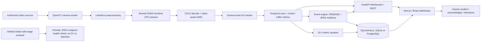

# GOD'S EYE — System Architecture

## Design decisions

- **Inference:** COCO-pretrained YOLOv8n exported to a dynamic-shape ONNX graph and executed with ONNX Runtime CPU. The machine available to this project has 2 CPU cores, ~1.9 GB RAM and no GPU. A PyTorch GPU runtime, MediaPipe stack, TensorRT and per-camera model copies are therefore not appropriate defaults. PyTorch/Ultralytics remain build-time export dependencies only; they are not required for serving.
- **Resolution:** the operator can select 320–640 px (multiples of 32). Lower resolution improves throughput but has not been validated for accuracy on a labelled target dataset.
- **Tracking:** camera-local IoU association with short-lived integer IDs. It is not re-identification, and IDs are not correlated across cameras.
- **Temporal cues:** movement-history + bounding-box geometry and persistence support an explicitly weak possible-fall cue; track age supports stationary-object review; image-plane displacement supports unusual-motion review. These are heuristics, not trained action recognition or threat/intent inference.
- **Multi-camera scheduling:** each camera has an independent async task. Capture is offloaded to threads; a shared inference lock serializes access to one ONNX session, preventing the demo from multiplying model memory. Camera workers process the latest frame and yield between work. This is a resource-aware prototype, not a throughput guarantee for many cameras.
- **Persistence:** SQLAlchemy targets SQLite locally and PostgreSQL via `DATABASE_URL`. Events, verification changes and 10-second camera metric samples are persisted. Video is processed without archival; uploaded source videos and evidence snapshots have a configurable expiration (default 24 h). Intel sample clips are fixed test assets, not user surveillance recordings.
- **Human oversight:** actionable safety cues start `PENDING`; operators may acknowledge, verify or dismiss. Informational source-lifecycle events remain in event history but are not counted as pending safety alerts; prerecorded demo startup does not create an alert event. There is no police, emergency-services or external-authority integration.
- **Geospatial UI:** MapLibre GL JS renders the OpenFreeMap/OpenStreetMap basemap plus a bundled, generalized Natural Earth Admin-1 reference overlay. Map marker coordinates are taken only from existing camera-registry records. The map is a navigation/context aid, not a legal-boundary or coverage product; see `docs/geospatial-map.md`.
- **Dashboard cadence and history:** overview/API data refreshes every 10 seconds; the UI clock is separate. Analytics filters actual retained samples/events by selected time window and omits unobserved/empty history rather than generating synthetic series. `/api/analytics.event_frequency` retains its existing event-row shape; additive `event_frequency_buckets` gives persisted event counts grouped into actual UTC hour buckets.

## Component flow

## API surface

- `GET /api/health` — process/model/CPU/memory/GPU status.
- `GET /api/overview` — aggregate current camera counts, alert count, FPS, hardware usage.
- `GET|POST /api/cameras`, `POST /api/cameras/upload`, `PATCH|DELETE /api/cameras/{id}` — authorised source management.
- `GET /api/cameras/{id}/snapshot` — no-store annotated frame.
- `GET /api/events`, `PATCH /api/events/{id}/verify` — history and operator workflow.
- `GET /api/analytics` — event history, category counts and retained metric samples.
- `GET|PUT /api/settings` — validated persistent model, resolution, confidence, crowd threshold, camera cap and retention settings.
- `WS /ws` — live camera metric updates and new-event messages. The web dashboard currently polls its same-origin REST proxy every 2.5 s; WebSocket remains available to API clients.

FastAPI exposes interactive OpenAPI docs at `/docs`.

## Resource limits and edge deployment

- On this two-core CPU, one shared session plus frame processing is the safe default. Verified image-refresh embeds use a separate periodic HTTP health worker and do not enter the video/CV worker. The registry currently has two attributed Chennai embeds and no verified Indian continuous video source.
- Benchmark results show FP32 at 320/416 px is substantially faster than at 640 px. Quantized INT8 weight-only was slower on this CPU and is not recommended here; ONNX quantisation must be benchmarked on the target's instruction set before deployment.
- **Raspberry Pi 4/5:** use 320 px, low feed cadence, one shared CPU session and conservative camera count; benchmark on the exact Pi/OS/NEON build. No Pi hardware experiment has been run.
- **Jetson:** export/convert the model for a supported TensorRT version and test FP16/INT8 with representative calibration data; neither a Jetson nor TensorRT was available here.
- **GPU workstation:** keep inference workers separate from the API, batch only if end-to-end latency allows, and use GPU ONNX Runtime or TensorRT. This deployment path is not performance-tested here.
- **Centralised processing:** can share accelerators and simplify model management but requires authorised network transport and increases bandwidth/privacy exposure. An edge-first installation reduces raw-video movement but has stricter thermal/compute limits. This prototype retains video locally and sends only metrics/events through the dashboard API.

## Known architectural limitations

The detector is COCO-trained, not fine-tuned for the VIT/campus camera domain. IoU tracking is less robust under heavy occlusion than ByteTrack/ReID-based trackers. Camera-specific calibration, line-crossing traffic measurement, pose-based fall validation, robust cross-view density calibration, auth/RBAC, deployment TLS and multi-node orchestration remain future work. Never expose this prototype as an unauthenticated public service.

## Fullscreen delivery and frame/telemetry synchronization

The camera worker publishes a decoded source frame, inference output and UTC timestamp in process memory. `GET /api/cameras/{camera_id}/frame` serializes the cached rendered/raw JPEG and corresponding detection/metrics payload with `Cache-Control: no-store`; the browser uses the returned JPEG itself rather than polling an image URL separately and drawing independently scaled boxes. Bounding boxes remain in detector frame coordinates in the returned metadata; the shown default overlay is rendered against the source frame server-side. This sidesteps object-fit and letterbox coordinate mismatch. A missing frame returns an error; the client clears prior imagery and current statistics and shows offline/reconnecting state. Video read failures clear cached frame/detections before retry. Files are labelled `DEMO`, continuing connected live video `LIVE`, and provider still-image embeds `IMAGE REFRESH` (never included in temporal CV). The fullscreen UI deliberately offers no unsupported playback/audio/quality control. UI telemetry charts use only received frames, and the screenshot caption records camera, location, timestamp, source state, model and current observed counts.

The API reports actual ONNX model metadata, runtime providers, input resolution, CPU/memory readings and `gpu_utilization_percent: null` when no GPU utilization probe is implemented. It must not derive GPU utilization from CPU statistics. Frame delivery and current-frame metadata were exercised with the bundled authorized-for-test development clip and the repository ONNX detector; this validates the local integration path only, not public-feed permissions or field performance.

## Prerecorded Indian traffic demonstration

The shipped `data/media/indian-urban-traffic-pexels-5009674.mp4` is Pexels video 5009674 by Meenakshi Vinay Rai. It is seeded as a `DEMO` file camera (country India; city and coordinates intentionally unset) and uses the existing OpenCV capture, YOLOv8n ONNX inference, tracker and matching frame endpoint. The viewer shows processed decoded frames rather than an independent HTML video so bounding boxes, class/confidence, timestamp, and counts stay paired with the actual inference frame. Pause/resume/replay controls change the backend file worker; a pause holds its last processed JPEG/detections, and replay seeks to the start and resets camera-local tracking. If CPU inference falls behind the source cadence, decoded frames are dropped against wall time so the clip does not simply play in slow motion; the reported inference FPS remains the actual achieved rate. The interface remains explicitly prerecorded and does not present demo FPS as live-camera performance. The source, license and endpoint checks are recorded in `data/media/INDIAN_DEMO_ATTRIBUTION.md`; the source page says India but not Chennai, so no Chennai attribution is made.
